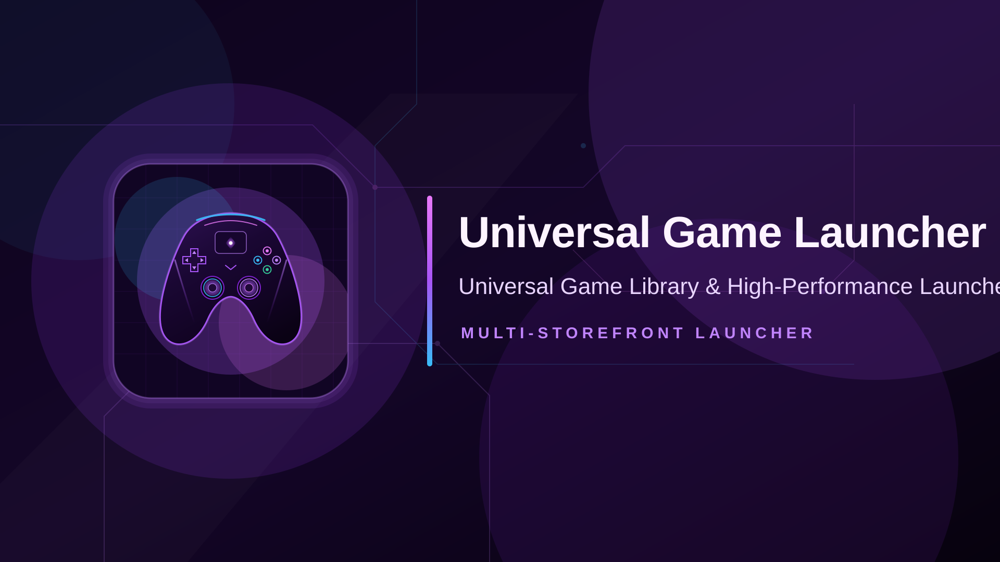

<div align="center">



# Universal Game Launcher

**A fast, lightweight, privacy-first universal game launcher and library organizer — built with Tauri v2.**

Organize, categorize, filter, and launch your entire multi-platform game library from a single unified desktop application without scraping or credentials.

</div>

---

## ✨ Overview

**Universal Game Launcher** aggregates your installed games and owned storefront libraries into a beautiful, high-performance desktop hub. It connects directly with your installed official launchers — including **Steam**, **Epic Games Store**, **GOG Galaxy**, **Ubisoft Connect**, **EA App**, **Xbox / Microsoft Store**, **Battle.net**, **itch.io**, and **Amazon Games**.

It serves as a clean-room, modernized revival of the library organization philosophies of [Depressurizer](https://github.com/rallion/depressurizer): it automatically discovers games from all installed launchers with full support for manually adding local games, lets you build and edit custom collections, filter with an advanced Allowed / Required / Excluded builder, auto-categorize by genre, developer, publisher, and tags, and manage local storage across drives.

Built on **Tauri v2** (Rust backend, SvelteKit + Svelte 5 frontend), Universal Game Launcher delivers instant launch performance, minimal memory footprint, and full offline functionality with zero scraping.

---

## 🧩 Features

- **Steam & GOG Left Games List Sidebar** — Dedicated to the Library view, featuring instant real-time search, quick filter pills (All, Installed, ★ Favorites), platform scan trigger (`↻ Scan`), and collapsible platform accordions with live game counts.
- **Dedicated Game Showcase View** — Rich selected game cockpit featuring high-resolution 16:9 hero wallpaper banner with dark vignette, portrait capsule, title typography, prominent PLAY NOW launch button, playtime metrics, and game details.
- **10-Image Screenshot Media Gallery** — Interactive media carousel supporting up to 10 screenshots with a fullscreen lightbox viewer.
- **Native Launcher Delegation Architecture** — Installation, launching, updating, and uninstallation delegate directly to installed official client protocols (`steam://`, `com.epicgames.launcher://`, `goggalaxy://`, `uplay://`). Never handles user credentials while preserving official client overlays, cloud save sync, friend lists, playtime tracking, and achievement unlocks.
- **Cross-Platform Free Games, Deals & Patch Notes Feed** — Real-time dashboard panel powered by GamerPower tracking verified 100% free game giveaways, store specials/discounts across major storefronts, and official game patch notes.
- **Multi-Drive Storage Footprint Analyzer** — Storage analytics cockpit with drive capacity/usage gauges and non-blocking background disk space calculation.
- **Custom Collections & Smart Categories** — Build custom collections, tag favorites, and evaluate dynamic filter rules evaluated locally with 0ms in-memory cache synchronization.
- **Custom Artwork Studio** — Inspect, customize, and fetch portrait capsules, hero banners, logos, and square icons across all games and manually added local titles via community providers and local image imports.
- **Modular In-App Plugin Framework** — Decoupled architecture where all 12 platform integrations (Steam, Epic, GOG, Xbox, EA, Ubisoft, Battle.net, itch.io, Amazon Games, Rockstar Games, Standalone, EmulationStation) and 11 metadata providers operate as isolated, dedicated TypeScript modules.
- **Tabbed Plugin Settings Dialog** — Decoupled configuration sub-window allowing per-plugin API keys (with password toggle), executable paths, and options with live credential connectivity testing.
- **Hand-Rolled Reactive i18n Localization** — Native reactive UI translations supporting 30 languages with zero runtime localization dependencies and Arabic RTL layout support.
- **Animated Splash Screen & Obsidian Purple Theme** — High-contrast dark purple visual identity (`#080511` / `#140d28` / `#a855f7`) with hardware-accelerated transforms and zero `backdrop-filter: blur` performance overhead.

---

## 🔌 Data Providers & Metadata Hierarchy

Universal Game Launcher enforces an authoritative role hierarchy between game platforms and metadata providers:
1. **Game Providers (Default Authoritative Source):** When games are detected, the platform provider plugin (Steam, Epic, GOG, itch, EA, EmulationStation, Standalone) fetches its own authoritative game details and artwork directly from its own source.
2. **Metadata Providers (Manual On-Demand Enhancement):** Third-party metadata providers are run on-demand by the user via **✨ Enhance Metadata** in the showcase view to enrich games and fill missing fields.
3. **Cache Reset Invariant:** Game providers are strictly prohibited from overwriting metadata contributed by metadata providers unless the user explicitly chooses to reset the metadata cache via **↺ Reset Cache to Provider Defaults**.

| Provider | Category | Key Required | Purpose |
| :--- | :---: | :---: | :--- |
| **Steam Store** (`metadata-steam`) | Metadata | ❌ No | Official genres, developers, publishers, release dates, reviews, 1080p screenshots |
| **GOG Catalog** (`metadata-gog`) | Metadata | ❌ No | Official GOG covers, heroes, game summaries, and DRM-free metadata |
| **Epic Games Store** (`metadata-epic`) | Metadata | ❌ No | Official EGS catalog details, promotional keyart covers, and release dates |
| **itch.io Store** (`metadata-itch`) | Metadata | ❌ No | Indie game descriptions, developer profiles, screenshots, and account sync |
| **SteamGridDB** (`metadata-steamgriddb`) | Metadata | ✅ Yes (Optional) | Community-crafted vertical capsules (600×900), heroes, logos, and square icons |
| **IGDB (Twitch)** (`metadata-igdb`) | Metadata | ✅ Yes (Optional) | Twitch IGDB game taxonomy, franchise links, developer studios, critic ratings |
| **TheGamesDB** (`metadata-thegamesdb`) | Metadata | ❌ No | Retro console metadata, authentic box art, fanart heroes, and clear logos |
| **ScreenScraper** (`metadata-screenscraper`) | Metadata | ❌ No | Multi-console ROM metadata, 2D/3D box art, wheel logos, and video snaps |
| **HowLongToBeat** (`metadata-howlongtobeat`) | Metadata | ❌ No | Crowd-sourced Main Story, Main + Extra, and Completionist playtime averages |
| **PCGamingWiki** (`metadata-pcgamingwiki`) | Metadata | ❌ No | Game engine, FOV/ultrawide fixes, controller flags, and save locations |
| **ProtonDB** (`metadata-protondb`) | Metadata | ❌ No | Linux & Steam Deck compatibility tiers (Native, Platinum, Gold) and launch tweaks |

> 💡 **Keyless Architecture**: Universal Game Launcher works fully out of the box without requiring API keys or user logins. External providers are used on-demand to enhance metadata and custom high-resolution artwork.

---

## 🔒 Privacy & Security

- **100% On-Device**: No telemetry, no usage analytics, no user accounts, and no background tracking.
- **Zero Credential Handling**: The app never prompts for, stores, transmits, or handles user passwords, payment information, or account tokens. All authentication and transactions remain strictly delegated to official storefront clients.
- **Local Persistence**: All settings, caches, and custom tags remain stored locally on your machine in `database.sqlite`.

---

## 🛠️ Tech Stack

- **Backend:** Rust 2021 / Tauri v2 (`src-tauri/`)
- **Frontend:** SvelteKit + Svelte 5 (Runes) + TypeScript + Vite (`src/`)
- **Database:** SQLite 3 in WAL mode via `rusqlite`
- **Cache Tier:** In-memory key-value cache
- **IPC:** Strongly-typed Tauri commands (camelCase JSON)

---

## 🚀 Building & Running

### Prerequisites

- **Rust** (stable toolchain)
- **Node.js 18+**
- Platform [Tauri system dependencies](https://tauri.app/start/prerequisites/) (WebView2 on Windows, WebKitGTK on Linux)
- **Windows System Runtimes:**
  - [Microsoft Visual C++ 2015–2022 Redistributable (x64)](https://aka.ms/vs/17/release/vc_redist.x64.exe) — required for native MSVC dependencies and bundled SQLite operations.

```bash
npm install
npm run tauri:dev     # development
npm run tauri:build   # production bundle
```

Both commands run through the logging wrappers in [`scripts/`](./scripts): output streams live to the console **and** is written to a timestamped transcript in [`logs/`](./logs) (`<type>-<YYYY-MM-DD_HH-MM-SS>.log`, never overwritten).

---

### Tests & Verification

Every check runs through an agent-friendly test runner that streams output live, writes timestamped transcripts to `logs/`, enforces per-step timeouts, and prints a compact PASS/FAIL summary:

```bash
npm test                 # cargo check + cargo test + svelte-check
npm run test:rust        # cargo test only
npm run test:frontend    # svelte-kit sync + svelte-check only
npm run verify           # check + tests + svelte-check + vite build
npm run test:all         # fmt + clippy + check + tests + svelte-check + build
```


---

### ✍️ Code Signing

Both local development builds and release packages support opt-in code signing:

```bash
npm run sign             # Signs discovered platform artifacts (.exe/.msi, .app/.dmg, .deb/.AppImage)
npm run sign:local       # Alias for local signing
npm run sign -- --dry-run
```

---

## 📄 License

BSD-3-Clause. See [`LICENSE`](./LICENSE).

## 🙏 Credits

Inspired by **Depressurizer** by Andrew Martin (rallion) and contributors. Universal Game Launcher is an independent clean-room implementation and is not affiliated with Valve, Microsoft, Epic Games, or Depressurizer.
