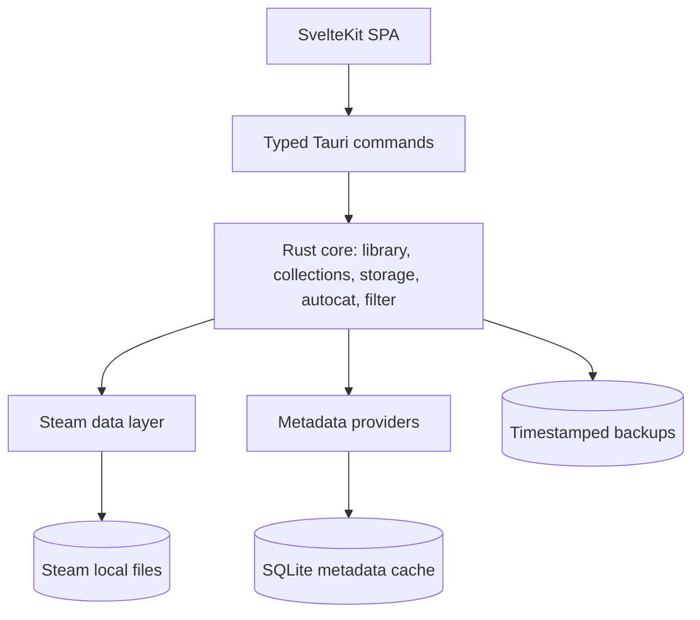
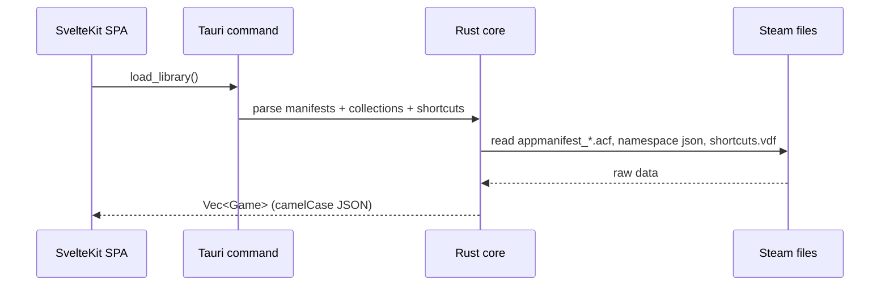

# Architecture

Steam Vault is a single desktop process with two halves: a **Rust / Tauri v2 backend** that owns all
Steam data access, and a **SvelteKit static SPA** that renders the interface and calls the backend
over typed IPC.

The design rule is simple: **the frontend never touches the filesystem**. Every read and write goes
through a Rust command, which is where validation, Steam-closed checks, and backups live.

## 🧱 Module map

The backend is split into focused modules:

| Module | Responsibility |
| :--- | :--- |
| `steam/` | Locating Steam, parsing Valve KeyValues (text and binary), reading libraries, collections, and shortcuts, and moving installed games between library folders. |
| `metadata/` | One client per provider, plus the shared HTTP client and provider registry. |
| `autocat` | The rule engine that turns metadata into proposed collections. |
| `filter` | The Allowed / Required / Excluded filter model. |
| `cache` | Embedded SQLite database (`metadata.db`) with WAL mode, indexing, TTL checking, and precompiled Community Game Catalog seed (`catalog_seed.bin` / `catalog.db`). |
| `settings` | Loading and saving local settings and API keys. |
| `backup` | Timestamped file backups taken before any write. |
| `commands` | The Tauri IPC surface and shared application state. |

## 🔁 Typical flow

For writes, the same path applies with two extra guards: the app checks that Steam is not running,
and it backs up the target file before modifying it.

## 🎯 Design goals

- **Resilience** — read documented local formats and public APIs, never scrape HTML.
- **Safety** — refuse risky writes and make every write reversible.
- **Clarity** — keep Steam knowledge in one layer and the UI free of filesystem concerns.

## ➡️ Next

- [Steam Data Layer](Steam-Data-Layer.md)
- [Backend (Rust)](Backend-Rust.md)
