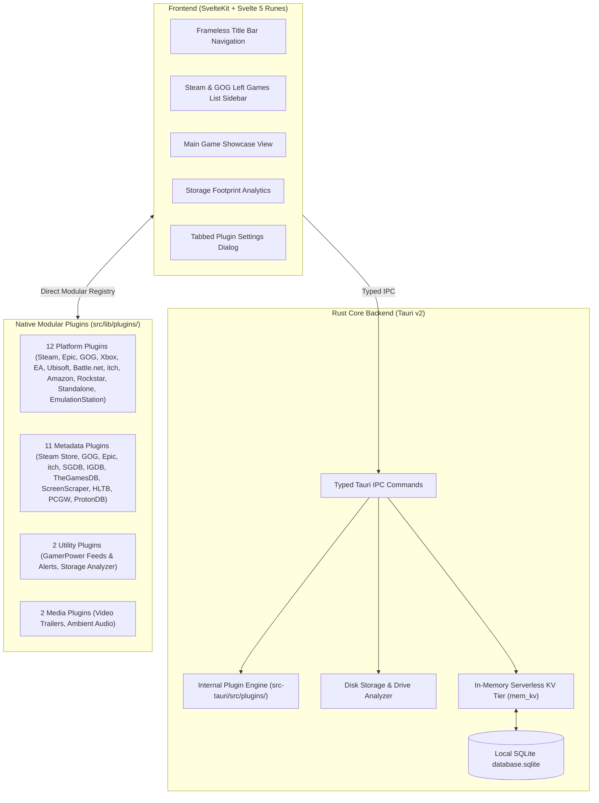

# Architecture

Universal Game Launcher is built on a high-performance, decoupled architecture:
- **Core Launcher**: Owns the user interface (frameless title bar navigation, Steam & GOG-style left sidebar, main game showcase, media gallery, artwork studio), storage footprint analytics, local persistence (`database.sqlite`), in-memory KV caching (`mem_kv`), and IPC bridge.
- **In-App Modular Plugin Ecosystem (`src/lib/plugins/`)**: All external features — platform storefront integrations, emulation & ROM systems, and metadata providers — are decoupled into modular, dedicated plugins implementing the `UniversalPlugin` framework.

---

## 🧱 Architectural Division of Responsibilities

### 1. The Core Application
1. **Ergonomic UI System:**
   - **Custom Titlebar Navigation:** Seamless switching between Dashboard, Library, Store, Social, Storage, Plugins, and Settings with instant 0ms tab rendering.
   - **Steam & GOG Galaxy-Style Left Sidebar:** Dedicated to the Library view with instant search filter, status pills (All, Installed, ★ Favorites), platform accordions with live game counts, and collections tree.
   - **Main Game Showcase View:** 16:9 hero wallpaper banner with dark vignette, title logo typography, prominent PLAY NOW launch button, 10-screenshot gallery with fullscreen lightbox, and custom artwork studio.
2. **Universal Non-Blocking Background Workers:**
   - Heavy filesystem and disk scans are offloaded to background threads via `tauri::async_runtime::spawn_blocking`, eliminating UI hangs across all tabs.
3. **Internal Necessary Files & Persistence:**
   - **Generic SQLite Persistence (`database.sqlite`):** Stores custom collections, user title overrides, favorite flags, and artwork paths in WAL mode.
   - **In-Memory KV Tier (`mem_kv`):** Provides sub-millisecond retrieval of games and collections with zero UI hang.
4. **Internal Plugin Engine (`src-tauri/src/plugins/`):**
   - Provides internal Rust support for platform scanning, launch protocol generation, and store CDN artwork resolution.
   - Built directly into the core `universal_game_launcher_lib` without detached crate overhead or loose JSON files.

### 2. Features Provided via Plugins (`src/lib/plugins/`)
All external integrations are decoupled into the in-app modular plugin ecosystem:
- **Game Platform Integrations (`src/lib/plugins/platforms/`):** Discovering installed titles, querying native store metadata, and delegating launch protocols for Steam, Epic Games (official launcher or optional Legendary CLI), GOG Galaxy, Xbox, EA Desktop, Ubisoft Connect, Battle.net, itch.io, Amazon Games, Rockstar Games, Standalone Executables, and EmulationStation.
- **Metadata Providers (`src/lib/plugins/metadata/`):** Retrieving covers, heroes, descriptions, release years, tags, and reviews via Steam Store, GOG Catalog, Epic Games Store, itch.io, SteamGridDB, IGDB, TheGamesDB, ScreenScraper, PCGamingWiki, ProtonDB, and HowLongToBeat.
- **Utility Plugins (`src/lib/plugins/utility/`):** Delivering live notifications, giveaways, deals, patch notes, and disk storage inspection via GamerPower and Storage Analyzer.
- **Media Enhancements (`src/lib/plugins/media/`):** Video trailer streaming and ambient game soundtrack playback.
- **Decoupled Settings Forms:** Each plugin exports its own `PluginSettingsConfig` schema, rendered inside the dedicated tabbed `PluginSettingsDialog.svelte` sub-window.

---

## 🔒 Non-Invasive Safety & Isolation Invariant

The core launcher operates completely non-invasively:
- **Zero External File Writes:** Never modifies or writes to external client files (no Steam VDF tampering).
- **Never Blocks Clients:** Never requires storefront clients to be closed during normal operation.
- **Zero Credential Harvesting:** Never handles or stores user passwords or login credentials.
- **Cache Reset Invariant:** Game providers cannot overwrite metadata contributed by metadata providers unless the user explicitly resets the metadata cache.

---

## ➡️ Next Steps

- [Plugins Architecture & Ecosystem](Plugins-Architecture.md) — deep dive into the plugin engine.
- [Plugin Developer Guide](Plugin-Developer-Guide.md) — step-by-step developer tutorial with templates.
- [Backend (Rust)](Backend-Rust.md) — IPC commands and database layer.
