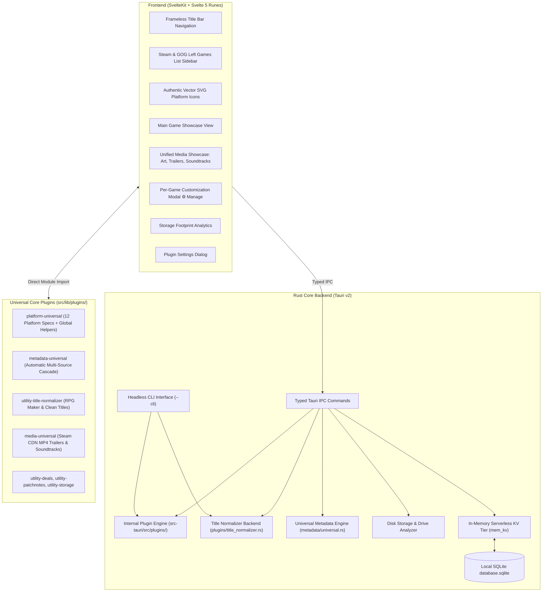

# Architecture

Universal Game Launcher is built on a high-performance, decoupled architecture:
- **Core Launcher**: Owns the user interface (frameless title bar navigation, Steam & GOG-style left sidebar, main game showcase, unified media tabs, per-game customization modal, storage analytics), local persistence (`database.sqlite`), in-memory KV caching (`mem_kv`), headless CLI (`--cli`), and IPC bridge.
- **Universal Core Plugins Ecosystem (`src/lib/plugins/`)**: Platform storefront integrations, emulation & ROM systems, automatic multi-source metadata cascades, title normalization, and media engines are decoupled into Universal Core Plugins paired with Global Helper Modules.

---

## 🧱 Architectural Division of Responsibilities

### 1. The Core Application
1. **Ergonomic UI System:**
   - **Custom Titlebar Navigation:** Seamless switching between Dashboard, Library, Store, Social, Storage, and Settings with instant 0ms tab rendering.
   - **Steam & GOG Galaxy-Style Left Sidebar:** Dedicated strictly to the Library view with instant search filter, status pills (All, Installed, ★ Favorites), background scan trigger (`↻ Scan`), collapsible platform/console accordions, and collections tree.
   - **Authentic Vector SVG Platform Icons (`PlatformIcon.svelte`):** Pixel-perfect vector SVGs for all PC storefronts and retro consoles across sidebar, showcase, and settings.
   - **Main Game Showcase View:** 16:9 hero wallpaper banner with dark vignette, title logo typography, prominent PLAY NOW launch button, playtime counters, and favorite toggle.
   - **Consolidated Unified Media Showcase:** Streamlined media section with dynamic tabs: **🖼️ Screenshots & Art** (with fullscreen lightbox), **🎬 Trailers** (streaming modern Steam Akamai MP4 videos), and **🎵 Soundtracks** (ambient theme playback).
   - **Per-Game Customization Modal (`⚙ Manage`):** Allows directly editing game Title, Short Description, Developers, Publishers, Release Date, Genres, and Custom Artwork (Capsule, Hero, Logo via URL or local file picker).
2. **Universal Non-Blocking Background Workers:**
   - Heavy filesystem and disk scans are offloaded to background threads via `tauri::async_runtime::spawn_blocking`, eliminating UI hangs across all tabs.
3. **Internal Necessary Files & Persistence:**
   - **Generic SQLite Persistence (`database.sqlite`):** Stores custom collections, user title overrides, favorite flags, and artwork paths in WAL mode.
   - **In-Memory KV Tier (`mem_kv`):** Provides sub-millisecond retrieval of games and collections (`game_meta:<appId>`, `library:custom_games`) with zero UI hang.
4. **Internal Plugin Engine & Rust Metadata Modules:**
   - `src-tauri/src/plugins/title_normalizer.rs`: Dedicated Rust title normalization engine.
   - `src-tauri/src/metadata/universal.rs`: Automatic multi-source metadata resolver cascading across Local Inspector, Libretro, Steam Store, GOG, Wikipedia/Wikidata, and PCGamingWiki.
5. **Headless CLI Interface (`--cli`):**
   - Headless execution engine supporting automated library scanning (`--cli scan`), ROM scanning, scaffolding, and title normalization verification.

### 2. Universal Core Plugins (`src/lib/plugins/`)
- **Universal Platform Engine (`platform-universal`):** Discovers installed titles, manages launch protocols, social rosters, and achievements across all 12 platforms (Steam, Epic Games with Legendary CLI, GOG Galaxy, Xbox, EA Desktop, Ubisoft Connect, Battle.net, itch.io, Amazon Games, Rockstar Games, Standalone, and EmulationStation) paired with global helper functions (`getAllPlatformSpecs()`, `detectPlatformLauncher()`, `installPlatformLauncher()`, `getPlatformLaunchSpec()`, `getPlatformUris()`).
- **Universal Metadata Engine (`metadata-universal`):** Automatic multi-source metadata resolution cascading across Local Inspector, Libretro CDN, Steam Store, GOG Catalog v1, Wikipedia + Wikidata MediaWiki API, PCGamingWiki Cargo API, ProtonDB, SteamGridDB, and IGDB.
- **Universal Title Normalizer (`utility-title-normalizer`):** Cleans RPG Maker titles (`System.json`), splits lowercase slugs, inverts articles, and strips ROM dump tags.
- **Universal Media Engine (`media-universal`):** Extracts modern Steam CDN MP4 trailer streams and plays ambient soundtrack themes.
- **Utility Plugins (`utility-deals`, `utility-patchnotes`, `utility-storage`):** Delivers live giveaway alerts, deals, patch notes, and non-blocking drive capacity analysis.

---

## 🔒 Non-Invasive Safety & Isolation Invariant

The core launcher operates completely non-invasively:
- **Zero External File Writes:** Never modifies or writes to external client files (no Steam VDF tampering).
- **Never Blocks Clients:** Never requires storefront clients to be closed during normal operation.
- **Zero Credential Harvesting:** Never handles or stores user passwords or login credentials.
- **Settings-Only Cache Maintenance:** Cache refresh and cache purge actions live cleanly in **Settings → Storage & Cache** (`↻ Refresh Metadata Cache`, `🗑 Purge Data Cache`), preserving custom user overrides.

---

## ➡️ Next Steps

- [Plugins Architecture & Ecosystem](Plugins-Architecture.md) — deep dive into the Universal Core plugins framework.
- [Plugin Developer Guide](Plugin-Developer-Guide.md) — step-by-step developer tutorial with templates.
- [Backend (Rust)](Backend-Rust.md) — IPC commands and database layer.
- [Frontend (SvelteKit)](Frontend-SvelteKit.md) — UI architecture and Svelte 5 Runes.
